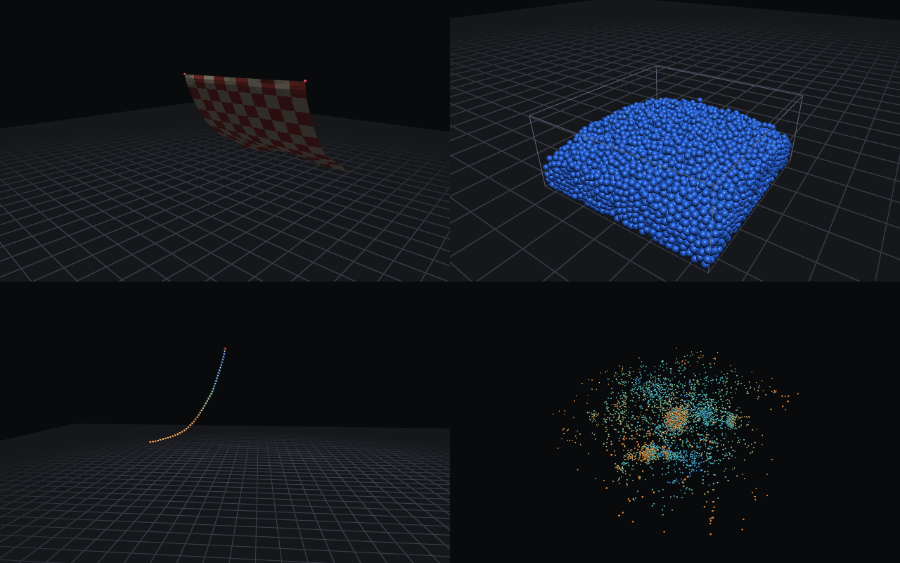

# physicall

physicall simulates cloth, a rope, a pile of grains and N-body gravity on the GPU, in the
browser. The physics is Rust compiled to WebAssembly and runs as WebGPU compute shaders through
wgpu 30. Every shader has a CPU twin in a crate with no GPU code, and the tests hold both to the
same answers.

Live demo: https://kubanemil.github.io/physicall/ (needs a browser with WebGPU)

<!-- DEMO GIF: record the live demo (drag the cloth, drop the pile, watch the N-body collapse) and put it here, above the still. -->



These frames come from the demo's own renderer, drawn offscreen on lavapipe.

## Why it is built this way

A physics shader can be wrong and still look right. A race between two threads writing one
particle, or a pass that reads data a moment too early, gives motion that looks plausible until a
resting pile slowly sinks. So the physics exists twice. `physicall-core` solves everything on the
CPU in plain Rust, and its tests compare it with results worked out on paper: a pendulum's period,
a hanging chain's catenary, a Kepler orbit's energy. `physicall-gpu` runs the same steps in the
same order as compute shaders, and its tests run both on a real GPU adapter and compare positions.
A shader bug shows up as a gap between the two.

The results do not depend on the frame rate. The page turns real time into fixed 1/60 s steps,
each split into substeps, and a test runs the same scene at 30, 45, 60, 144 and 240 fps and gets
bit-identical positions.

## Architecture

```
  web/             TypeScript page (Vite): scene picker, sliders built from the
                   solver's parameter table, energy and momentum readout, input
        |
        |  wasm-bindgen
        v
  physicall-web    App: WebGPU device and canvas, orbit camera, picking,
                   fixed-step clock, renderer that draws from the sim buffers,
                   readback every 4th frame for diagnostics and picking
        |
        v
  physicall-gpu    compute pipelines, one per kernel
                   XPBD substep: predict > solve colour 1..k > hash: clear, count,
                                 scan, scatter, sort > contacts > finish
                   N-body step:  kick-drift > tiled gravity and kick
                   shared structs: one Rust declaration gives the repr(C) type,
                                 its WGSL and compile-time layout asserts
        |
        v
  physicall-core   the same algorithms on the CPU, no GPU code: XPBD, colouring,
                   tethers, spatial hash, contacts, leapfrog N-body,
                   diagnostics, fixed-step clock, scenes
```

## Algorithms

- XPBD distance constraints with compliance in m/N (Macklin, Müller, Chentanez 2016, "XPBD:
  Position-Based Simulation of Compliant Constrained Dynamics"). Each fixed step runs N
  substeps with one solver pass each (Macklin et al. 2019, "Small Steps in Physics
  Simulation"). Velocity is the substep's displacement divided by its length. Air drag is a
  rate in 1/s on velocity, so it never moves a body at rest.
- Gauss-Seidel over a graph colouring. Constraints are coloured greedily so no two in a colour
  share a moving particle, and each colour is one dispatch. The CPU solves the colours in the
  same order.
- Long range attachments (Kim, Chentanez, Müller 2012) tie every cloth and rope particle to its
  pins with a one-sided distance limit. They cut the cloth's stretch at the pins from 17% to
  0.5%.
- A spatial hash: a uniform grid with cells one particle wide, hashed into a table with the
  primes of Teschner et al. 2003 ("Optimized Spatial Hashing for Collision Detection of
  Deformable Objects"). Each substep rebuilds it by counting sort: atomic counts, a prefix sum
  in one workgroup, a scatter, and a sort inside each bucket so runs are reproducible.
- Particle contacts with Jacobi iterations, constraint averaging and position-based Coulomb
  friction (Macklin et al. 2014, "Unified Particle Physics for Real-Time Applications").
- N-body gravity by direct summation with Plummer softening, tiled through workgroup memory
  (Nyland, Harris, Prins 2007, GPU Gems 3 ch. 31), integrated with kick-drift-kick leapfrog.

## Validation

`./do test` runs all of these. CI runs them on every pull request, with the GPU tests on
lavapipe, Mesa's software Vulkan driver.

| What | Checked against | Tolerance | Measured |
| --- | --- | --- | --- |
| Pendulum, 0.05 rad, 10 substeps | period vs 2π√(L/g)(1 + θ²/16) | 0.1% | 0.04% |
| Hanging chain, 30 links | heights vs the catenary of the same length | 1.5 mm on a 1 m span | 0.84 mm |
| Compliant link, 4 and 16 substeps | stretch vs Hooke's law, α·m·g | 1% | 0.23% |
| Hanging chain, compliance 10⁻² to 0 | strain falls as compliance falls; soft case vs Hooke | 5% | 0.33% |
| Rigid chain, 5 to 40 substeps | error ratio per halved substep | 3.5 to 4.5 | 4.0 |
| Cloth pinned at two corners | worst link strain | 2% | 0.5% |
| Rope and cloth at 30 to 240 fps | positions after 2 s | bit-identical | bit-identical |
| Kepler orbit, e = 0.5, 20 orbits | energy error; drift from orbit 1 to 20 | 2×10⁻⁴; 10⁻⁴ | 3.5×10⁻⁵; 1.8×10⁻⁵ |
| Kepler orbit, one period | distance from the start | 5×10⁻⁴ | 3×10⁻⁵ |
| 256 bodies, 300 steps | momentum change over Σm\|v\| | 10⁻⁶ | 8×10⁻⁸ |
| 512 softened bodies, 4 time units | energy error | 10⁻³ | 1.1×10⁻⁴ |
| Spatial hash, random sets | neighbours vs brute force, tables of 1 to 4096 buckets | exact | exact |
| 1200 grains dropped in a box | deepest overlap; never above the drop height | 10% of radius | 5.2% |
| Grain sliding on the floor | distance vs v²/(2μg) | 5 mm | 0.8 mm |
| GPU vs CPU: rope, 60 steps | largest position gap | 0.1 mm | 0 |
| GPU vs CPU: cloth, 20 steps | largest position gap | 0.5 mm | 0.065 mm |
| GPU vs CPU: 100 colliding pairs, 30 steps | largest position gap | 0.1 mm | 0.003 mm |
| GPU vs CPU: 1000 bodies, 30 steps | largest position gap | 10⁻⁴ | 1.1×10⁻⁷ |
| GPU vs CPU: spatial hash | bucket offsets and contents | exact | exact |
| GPU vs CPU: settled pile | mean height | 2% | 0.2% |
| Shared structs | Rust offsets vs WGSL offsets | compile time, plus naga | match |
| Every scene | renders with no wgpu validation errors | none | none |

Two limits showed up while measuring. Positions are f32 to match the GPU, and at metre scale a
substep shorter than about 1/1000 s rounds away part of each gravity step: the pendulum's period
error grows from 0.04% at 10 substeps to 1.1% at 80. The defaults stay where smaller steps still
help. And GPUs fuse multiply-adds that the CPU rounds twice, so GPU and CPU runs start one
rounding step apart. Folding cloth and falling grains magnify that, which is why those checks use
short runs, isolated collisions or statistics.

## Layout

```
crates/physicall-core/    CPU reference, no GPU code
  src/xpbd.rs             substep loop, distance solve, velocity update
  src/constraint.rs       constraints, materials, graph colouring
  src/contact.rs          Jacobi contacts, friction, floor and walls
  src/hash.rs             counting-sort spatial hash
  src/nbody.rs            softened gravity, leapfrog
  src/scene.rs            the demo scenes and their parameter table
  tests/                  behaviour tests against analytic results
crates/physicall-gpu/     wgpu kernels that mirror the core
  shaders/                integrate, solve, grid (hash and contacts), nbody
  src/layout.rs           structs shared with WGSL, layout asserts
  tests/                  GPU against CPU
crates/physicall-web/     wasm-bindgen App, renderer, camera, picking
web/                      the page, Vite and TypeScript
```

## Development

You need Rust (tested on 1.99) with the `wasm32-unknown-unknown` target, wasm-pack and Node 24.

```
./do test     every test; GPU tests skip with a notice when there is no adapter
./do check    rustfmt, clippy for native and wasm32 with warnings as errors, tsc
./do fmt      format the Rust code
./do dev      build the wasm package and serve the page on localhost:5173
./do build    release wasm package
./do web      static site in web/dist
```

Set `PHYSICALL_REQUIRE_GPU=1` to make a missing adapter fail the GPU tests, as CI does. On Linux
without a GPU, the `mesa-vulkan-drivers` package provides lavapipe.

In the demo, drag to orbit, shift or right drag to pan, scroll to zoom and drag a particle to pull
it. Space pauses and R resets. XPBD scenes use SI units; the N-body scene uses G = 1.

## Decisions

| Choice | Not chosen | Why |
| --- | --- | --- |
| Gauss-Seidel over colours | Jacobi with averaged corrections | Gauss-Seidel converges faster per pass and needs no float atomics, which WebGPU does not have. Inside a colour the order does not matter, so the CPU gets the GPU's answer. The cost is one dispatch per colour (14 for the cloth); links never change, so colouring happens once. |
| Jacobi with averaging for contacts | Colouring contacts as well | Contact pairs change every substep, and colouring them on the GPU each time costs more than averaging. |
| Many substeps, one pass each | Several passes per substep | Error falls with the square of the substep. For the pile, 20 substeps of one pass overlap 5%, while 10 substeps of four passes overlap 10%. |
| Fixed 1/60 s steps from an accumulator | A step per frame | Results depend on simulated time only. A frame that falls behind drops time instead of taking a bigger step. |
| Tethers on pinned cloth and rope | More substeps | They remove most of the stretch near the pins for one extra dispatch per pin. |
| Drag as a rate on velocity | A damping factor per frame | It has units, does not change with frame rate and leaves a resting body alone. |
| Contact relaxation of 1 | Over-relaxation | Velocity comes from displacement, so overshooting throws grains. At 1.5 they flew to 5.7 m after a 1.2 m drop. |
| Leapfrog | Semi-implicit Euler | Same cost, but second order and time-reversible, so the energy error stays bounded. |
| Direct gravity in tiles | Barnes-Hut | Exact forces and a short kernel, fast enough for 16k bodies. |
| f32 on both sides | An f64 CPU reference | The reference meets the same rounding as the GPU, so the comparison can be tight. |
| Shared structs declared once in Rust | WGSL structs copied by hand | A macro writes the WGSL and asserts every offset at compile time. A naga test checks the layouts again. |

## Roadmap

Milestone 2:

- 3D soft bodies from tetrahedral meshes, with XPBD volume constraints coloured like the cloth.
- Barnes-Hut gravity, for N-body sizes direct summation cannot run at 60 fps.
- Rigid bodies with the XPBD rigid body solver (Müller et al. 2020, "Detailed Rigid Body
  Simulation with Extended Position Based Dynamics"), colliding with grains.
- Cloth self-collision through the spatial hash.

## License

MIT
